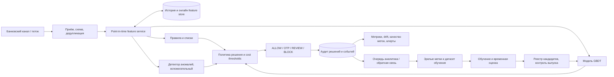

# Техническое задание, план и архитектура антифрод-модели

**Версия:** 1.0  
**Статус:** проектный документ для прототипа и пилота  
**Дата:** 25 ноября 2026 г.

## 1. Цель и границы

Построить сервис, который оценивает риск банковского перевода до его окончательного исполнения, выбирает действие `ALLOW`, `OTP`, `REVIEW` или `BLOCK`, сохраняет объяснимые результаты и позволяет аналитикам размечать случаи мошенничества. Модель должна работать с редкими положительными примерами, учитывать временной порядок операций и не использовать сведения, которые становятся известны после решения.

В текущем репозитории уже реализован исследовательский прототип: потоковая генерация признаков, хронологическое разбиение, GBDT, Isolation Forest, правила, пороговая политика, FastAPI, Streamlit, обратная связь и PSI-мониторинг. Эта спецификация описывает целевую систему и оставшиеся работы перед реальным пилотом. Она не утверждает, что текущие результаты подтверждают качество на банковских данных.

### Цели продукта

- Выявлять известные сценарии мошенничества и направлять сомнительные переводы на дополнительную проверку.
- Ограничивать потери от пропуска мошенничества при контроле ложных блокировок и нагрузки на аналитиков.
- Обеспечивать воспроизводимость решения: версия модели, признаки, исходные оценки, сработавшие правила и время скоринга.
- Поддерживать аудит, обратную связь аналитика и безопасное обновление модели.

### Вне рамок первой версии

- Автоматическое расследование или закрытие клиентских счетов.
- Применение генеративной модели для выставления риска или принятия решения.
- Автоматическое переобучение и публикация модели без проверки качества и контролируемого выпуска.
- Утверждение юридических оснований обработки данных или бизнес-стоимостей вместо владельцев банка.

## 2. Данные и предположения

В репозитории находится `data/paysim dataset.csv`. По заголовку CSV содержит поля:

| Поле | Назначение | Использование |
|---|---|---|
| `step` | временной шаг PaySim | порядок событий; не точная дата и время |
| `type` | тип операции | категориальный признак |
| `amount` | сумма операции | числовой признак; валюта/масштаб должны быть подтверждены |
| `nameOrig`, `nameDest` | псевдонимы отправителя и получателя | построение истории и агрегатов, исключить как сырые ID из модели |
| `oldbalanceOrg`, `newbalanceOrig` | баланс отправителя до/после | балансные признаки, доступность до решения требует подтверждения |
| `oldbalanceDest`, `newbalanceDest` | баланс получателя до/после | потенциальный риск утечки: использовать только если значения известны на момент скоринга |
| `isFraud` | целевая метка | целевой класс для обучения/оценки |
| `isFlaggedFraud` | результат исходного правила PaySim | не использовать как вход в модель; можно анализировать отдельно |

CSV не содержит отдельного `tx_id`, абсолютного `timestamp`, канала, устройства или IP-страны. `src/data/simulator.py` генерирует обогащённые синтетические события с такими полями и сценариями мошенничества. В документации и отчётах эти два источника должны называться раздельно: **исходный PaySim CSV** и **обогащённая симуляция проекта**. Не приписывать CSV признаки, которых в нём нет.

Перед обучением нужно зафиксировать версию/источник Kaggle-файла, схему, число строк, долю классов, дубликаты, пропуски, диапазоны значений и временной охват. Эти статистики записать в manifest набора данных, не полагаясь только на имя файла. Метки `isFraud` в PaySim синтетические; они полезны для отладки пайплайна, но не являются доказательством переносимости на банковский мошеннический поток.

### Контракт доступности признаков

Для каждого поля владелец данных подтверждает, что оно доступно именно в момент принятия решения. `newbalanceOrg`, `newbalanceDest` и иные посттранзакционные значения исключаются, если формируются после исполнения/проводки. Сырые `nameOrig` и `nameDest` служат ключами для point-in-time агрегатов, но не должны попадать в модель как произвольные идентификаторы. `isFlaggedFraud`, результаты расследования, chargeback и поздняя разметка запрещены среди входов модели.

## 3. Функциональные требования

1. Принимать транзакцию с устойчивым уникальным идентификатором, UTC-временем события, суммой, типом, отправителем/получателем и только доступными до решения банковскими атрибутами.
2. Проверять типы, диапазоны, обязательные поля, дубликаты и порядок событий. Повтор запроса с тем же ID должен быть идемпотентным; конфликтующая повторная нагрузка должна отклоняться.
3. Строить признаки строго по информации, доступной до текущей операции: частота/сумма операций за окна, время с предыдущей операции, отклонение суммы от собственной истории, новизна получателя, агрегаты получателя и сетевые паттерны — только при наличии соответствующих источников.
4. Возвращать вероятность/оценку риска, действие, сработавшие правила, краткие факторы объяснения, версию модели и задержку. Ответ должен включать технический статус, пригодный для безопасного fallback при недоступности сервиса.
5. Сохранять входной снимок, вычисленные признаки или их версию, результаты компонентов, решение, время, версию модели и последующую метку с аудитом изменений.
6. Предоставлять очередь случаев для аналитика, разметку `fraud/not_fraud/unknown`, комментарий и время/источник метки.
7. Поддерживать offline-обучение, оценку кандидата, согласование выпуска, откат и мониторинг без перезаписи предыдущих артефактов.

## 4. Нефункциональные требования и критерии приёмки

Целевые значения ниже — **предлагаемые пороги пилота**, которые владелец продукта должен подтвердить по нагрузке и матрице потерь; они не измерены для реальной банковской среды.

| Область | Предлагаемый критерий пилота |
|---|---|
| Временная валидация | Train/validation/test разделены хронологически; признаки проверены на point-in-time корректность и отсутствие утечки |
| Ранжирование | PR-AUC и Precision@K выше согласованного baseline; дополнительно публикуются Recall при целевом FPR и метрики по сегментам |
| Операционная нагрузка | Доля и число `REVIEW` за сутки не превышают лимит команды аналитиков |
| Потери | Ожидаемая стоимость решений ниже baseline по согласованной матрице FN, FP, OTP, проверки и блокировки |
| Надёжность скоринга | Доступность и пропускная способность согласуются с каналом перевода; таймаут имеет утверждённый fallback |
| Задержка | Измерены p50/p95/p99 end-to-end на целевой инфраструктуре; числовой SLA устанавливается до интеграционного пилота |
| Воспроизводимость | Модель, схема признаков, конфигурация и датасет версионируются; обучение повторяется с фиксированной конфигурацией |
| Объяснимость | Для каждого `OTP/REVIEW/BLOCK` доступны факторы и правила, согласованные с аналитиками |
| Управление изменениями | Ни одна модель не становится активной без отчёта сравнения и одобренного выпуска; доступен откат |

Accuracy не использовать как основную метрику при сильном дисбалансе. Порог классификации нельзя выбирать только по F1 или на тестовой выборке: его выбирают на validation по согласованным денежным/операционным затратам, затем один раз оценивают на отложенном test.

## 5. Целевая архитектура

### Компоненты и ответственность

- **Приём:** API-шлюз, аутентификация сервиса к сервису, проверка схемы, rate limit, дедупликация по `tx_id`.
- **Feature service:** общая спецификация batch/online-признаков, UTC-время, агрегаты только по прошлым событиям, наблюдаемость cold start и пропусков. Нынешний `OnlineFeatureStore` полезен как прототип; для масштабирования состояние должно быть устойчивым к перезапуску и согласованным между репликами.
- **Decision service:** правила для детерминированных ограничений, GBDT для основного supervised score, Isolation Forest как дополнительный сигнал/монитор, политика порогов, приоритет явных жёстких правил. Аномальный скор не должен сам по себе означать мошенничество.
- **Хранилища:** операционные транзакции/решения и история обратной связи отдельно от версионируемого обучающего набора и модельных артефактов. В production вместо локальной SQLite/Parquet определить управляемые отказоустойчивые хранилища.
- **Обучающий контур:** проверка качества/схемы → временной split → обучение baseline и кандидата → калибровка/порог на validation → оценка test → отчёт → регистрация кандидата → контролируемая теневая/канареечная поставка → promotion/rollback.
- **Мониторинг:** технические метрики задержки/ошибок, распределения признаков и scores, доля действий, доступность фичей, качество на созревших метках, стоимость потерь и нагрузка на аналитиков. PSI — сигнал для расследования, не единственное основание переобучения.

Текущий код проекта соответствует большинству логических блоков, но локальный in-memory feature store, SQLite и синтетический поток не равнозначны отказоустойчивой банковской инфраструктуре. LLM-резюме, если включено, остаётся вспомогательным текстом; скоринг и действие должны быть детерминированны без него.

## 6. План работ

| Этап | Работы | Результат / условие перехода |
|---|---|---|
| 0. Уточнение требований | Согласовать канал, SLA, допустимые действия, цену пропуска/ложной блокировки, лимит аналитиков, правила fallback и владельцев | Подписанный контракт решения и матрица стоимости |
| 1. Профилирование источника | Подтвердить происхождение CSV; посчитать качество, классы, повторные события и временной охват; определить допустимость балансовых полей | Data manifest, схема и перечень ограничений |
| 2. Подготовка данных | Валидация, очистка по документированным правилам, генерация/проверка ID, UTC-порядок; разделение по времени; защита от утечек и дубликатов | Версионируемый датасет и воспроизводимый split |
| 3. Baseline и признаки | Простая модель на транзакционных признаках; затем point-in-time агрегаты отправителя/получателя; ablation по группам признаков | Сравнимый baseline и контракт признаков |
| 4. Обучение и решения | GBDT, анализ дисбаланса/калибровки, опциональный anomaly score; выбор порогов на validation по стоимости и capacity | Кандидат, отчёт метрик и обоснованная политика действий |
| 5. Верификация | Временной holdout, сценарии concept drift, оценка по сумме/типу/времени/сегментам; ручной анализ FP/FN; тест воспроизводимости | Отчёт качества, утечек и известных ограничений |
| 6. Интеграция и наблюдаемость | API, хранилище состояния, аудит, аналитическая очередь, мониторинг и безопасный fallback | Интеграционный стенд с измеренной нагрузкой и задержкой |
| 7. Теневой пилот | Считать решения без влияния на проводку; сверять с созревшими метками и аналитиками; валидировать объём очереди и drift | Решение о включении OTP/REVIEW/BLOCK с утверждёнными порогами |
| 8. Контролируемый выпуск | Ограниченный трафик, метрики guardrail, откат, регулярный пересмотр модели и правил | Runbook, владелец сервиса и процедура выпуска |

## 7. Методика обучения и оценки

1. Зафиксировать единую единицу наблюдения: одна строка соответствует одной попытке перевода; определить политику отмен, повторов и технических retry.
2. Удалить/объединить точные дубликаты идемпотентно; конфликтующие идентификаторы направлять на разбор.
3. Сортировать события по времени, с детерминированным вторичным ключом. В исходном CSV `step` имеет грубую гранулярность; при равном шаге произвольный порядок может искажать velocity и графовые признаки. Явно выбрать и задокументировать правило обработки одинаковых шагов.
4. Разбить по времени на train, validation и test. Feature state для строки test строится из предшествующих событий, но метки test не используются для состояния или подбора порога.
5. Сравнить минимум: простые правила, логистическую регрессию/простую baseline-модель, GBDT на допустимых текущих полях, GBDT с point-in-time поведенческими признаками. Проверить вклад каждого набора ablation.
6. Метрики: PR-AUC (Average Precision), ROC-AUC как дополнительная, Recall при заданном FPR, Precision@K, fraud capture rate/доля суммы, FP на тысячу/день, число отправленных на проверку, ожидаемая стоимость. Публиковать доверительные интервалы/разброс на нескольких временных срезах, если данных достаточно.
7. Выбрать пороги на validation с реальной матрицей затрат и ограничением capacity; не переносить значения порогов из симулятора.
8. После фиксации модели/порогов оценить один раз на test. После любого изменения модели, признаков или порога test становится использованным и нужен новый будущий holdout.

## 8. Эксплуатация, безопасность и риски

- **Запаздывающие метки:** задавать период созревания метки и статус `unknown`; не считать неразмеченные недавние операции отрицательными.
- **Смещение выборки:** решения системы могут менять, какие метки наблюдаются; отслеживать разницу охвата, учитывать отмены/OTP и выборочную проверку.
- **PII и безопасность:** применять псевдонимизацию идентификаторов, минимизацию данных, контроль доступа, шифрование, аудит, сроки хранения и запрет секретов в логах. Конкретные требования согласует владелец банка.
- **Сдвиг модели:** PSI и распределения помогают заметить изменение входа, но требуются также метрики по зрелым меткам и анализ причины. Автоматический retrain из `/retrain` не должен автоматически публиковать новую модель.
- **Переносимость метрик:** отчёт проекта показывает высокие метрики на созданной им синтетической выборке; они являются smoke/benchmark-результатами прототипа, не целевыми показателями и не прогнозом production.
- **Fail-safe:** при сбое feature/model service использовать утверждённую бизнесом политику (например, правила, задержка/повтор или ручной контроль), не придумывать поведение молча.

## 9. Соответствие текущему репозиторию

| Область | Уже есть | Требуется для пилота |
|---|---|---|
| Данные/симуляция | `data/paysim dataset.csv`, синтетический симулятор | Явно вести происхождение и статистику каждого набора; отдельно обучать/оценивать на исходном CSV и расширенных синтетических данных |
| Признаки | 35 признаков, `OnlineFeatureStore`, контракт в `docs/feature_contract.md` | Сопоставить каждый признак реальному источнику и доказать доступность к моменту решения |
| Обучение | GBDT, baseline, временной split, оптимизация порога, абляции | Кросс-периодная устойчивость, калибровка, зрелые реальные метки и model registry |
| Решение | Правила + GBDT + Isolation Forest, четыре действия, объяснения | Согласовать бизнес-политику, cost matrix, таймаут и fallback |
| API/аналитик | FastAPI, SQLite, Streamlit, feedback endpoint | Аутентификация/авторизация, отказоустойчивое состояние, аудит, эксплуатационный SLA |
| Мониторинг | PSI и качество на обратной связи | Алертинг/runbook, метрики по зрелым меткам, capacity и стоимость решений |

## 10. Открытые решения владельца продукта/данных

Перед интеграционным пилотом необходимо зафиксировать: валюту и денежный масштаб `amount`; фактическую семантику и момент доступности балансов; допустимое время ответа и поведение при таймауте; цену FN/FP/ложного `BLOCK`, стоимость OTP и ручной проверки; максимальный объём очереди; период созревания меток; допустимость и сроки использования идентификаторов; целевые каналы и формат реальных событий. До этого пороги и SLA в документе являются проектными предложениями.
